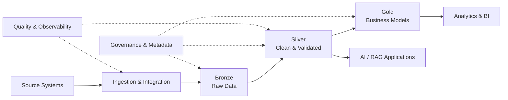

 

*Designing dependable data platforms — from ingestion and transformation to governance, analytics, and AI-ready data.*

---

## 👋 Profile

I’m a data professional focused on building trustworthy, analytics-ready data systems. My work and learning span data engineering, data management and governance, data quality, dimensional modeling, business intelligence, and applied AI.

I enjoy connecting the full data lifecycle: integrating data from multiple sources, organizing it into reliable lakehouse and warehouse layers, applying quality and governance practices, and making the resulting data useful for reporting and intelligent applications.

- **Data engineering:** ETL/ELT, orchestration, lakehouse architecture, incremental loading, and distributed processing.
- **Data management & governance:** data quality, profiling, validation, reconciliation, standardization, and DAMA-DMBOK / CDMP-aligned concepts.
- **Analytics:** dimensional modeling, star schemas, SQL, dashboards, and business-focused metrics.
- **Applied AI:** hands-on work with Retrieval-Augmented Generation (RAG) systems.
- **Knowledge sharing:** Data Engineering Instructor and Graduation Project Mentor at the Information Technology Institute (ITI).
- **Education:** Master’s in Data Science at Cairo University; B.Sc. in Computer and Control Engineering.

---

## 🧩 My Data Skillset

<table>
<tr>
<td width="50%" valign="top">

### 🏗️ Data Engineering & Platforms

**Core practices:** ETL/ELT · Pipeline orchestration · Medallion architecture · Incremental loading / CDC concepts · Lakehouse · Data warehousing · Distributed processing

</td>
<td width="50%" valign="top">

### 🛡️ Data Management & Governance

**Core practices:** Data profiling · Validation and reconciliation · Standardization · Data quality rules · Business definitions · Ownership concepts · Governance principles

*CDMP is referenced here as a framework of study and practice, not as a claim of certification.*

</td>
</tr>
<tr>
<td width="50%" valign="top">

### 📊 Analytics, Modeling & BI

**Core practices:** Star schema · Fact and dimension tables · Data warehouse design · KPI reporting · Data exploration · Data validation

</td>
<td width="50%" valign="top">

### 🤖 Applied AI & Development

**Focus:** Hands-on RAG system development · Data preparation for AI applications · Python-based workflows · Version control and reproducible projects

</td>
</tr>
</table>

---

## 🔬 Selected Hands-on Projects

### 1. End-to-End Data Platform on Microsoft Fabric
**Microsoft Fabric · Data Factory Pipelines · Lakehouse · PySpark · Delta Lake · Warehouse · Power BI**

- Built a parameterized ingestion workflow using HTTP, Lookup, ForEach, and Copy activities to ingest eight datasets from GitHub into a Lakehouse Bronze layer.
- Configured daily orchestration and pipeline-status notifications through Outlook and Microsoft Teams.
- Applied cleansing and validation in the Silver layer using PySpark and Delta Lake, including deduplication, null handling, and key checks.
- Implemented incremental loading using a watermark / CDC-style approach into a Warehouse.
- Designed a Gold-layer star schema and connected Power BI for sales analytics, with reported project metrics of **18.5M in sales** and **7.9M in profit**.

### 2. Retrieval-Augmented Generation (RAG)
**Applied AI · Retrieval · Context-grounded generation**

- Hands-on experience contributing to the development of a RAG system for an AI-powered application.
- Interested in the data foundations that make retrieval-based systems more useful: preparing source data, structuring content, and supporting relevant context retrieval.

### 3. Real-time Agricultural IoT Data Pipeline on AWS
**AWS IoT Core · Lambda · Redshift · CloudWatch · OpenSearch**

- Built a real-time ingestion and processing workflow for sensor data and weather API inputs.
- Used Amazon Redshift as a centralized warehouse for historical analysis and time-series data.
- Applied monitoring and observability practices using CloudWatch and OpenSearch.

### 4. Sales Data Warehouse & Data Quality
**SQL Server · ETL · Dimensional Modeling · Data Profiling**

- Designed a retail warehouse using conceptual, logical, and physical data modeling principles.
- Built a star schema with fact and dimension tables for sales reporting.
- Integrated more than 100,000 CRM and ERP records into a centralized SQL Server warehouse.
- Created checks for duplicates, missing values, inconsistent records, referential integrity, and business-rule validation.
- Improved data quality to **99%** in the project through resolving duplicate, missing, and inconsistent records.

> Project details and metrics reflect the project descriptions in my CV. Repository links can be added to each project heading as the code and documentation are published.

---

## 🔄 How I Think About Data

*My approach connects data engineering with quality, governance, analytics, and AI readiness across the data lifecycle.*

---

## 🎓 Education & Credentials

- **M.Sc. Data Science** — Cairo University, 2026–present
- **B.Sc. Computer and Control Engineering** — Higher Institute for Engineering and Technology, 2019–2024
- **AWS Certified Cloud Practitioner**
- **IBM Data Engineering Professional Certificate** — 2025
- **Salesforce Certified Tableau Desktop Foundations**
- **ITI Data Engineering Track** — Data warehousing, ETL/ELT, Informatica, Hadoop, Spark, and Databricks

---

## 📈 GitHub Activity

---

## 📄 CV & Contact

Interested in data engineering, data management, governance, analytics, or AI-enabled data solutions? Feel free to connect.

- **LinkedIn:** [linkedin.com/in/mustafa-rezk-](https://linkedin.com/in/mustafa-rezk-)
- **Email:** [mustafarezk436@gmail.com](mailto:mustafarezk436@gmail.com)
- **CV:** [Download Mustafa Rezk's Data Engineer CV](Mustafa_Rezk_Data_Engineer.pdf)

> **To enable the CV download:** upload `Mustafa_Rezk_Data_Engineer.pdf` to the root of this same profile repository. Keep the filename exactly the same as the link above, or update the link to match your chosen filename.

*Building reliable data foundations for better decisions and intelligent applications.*

